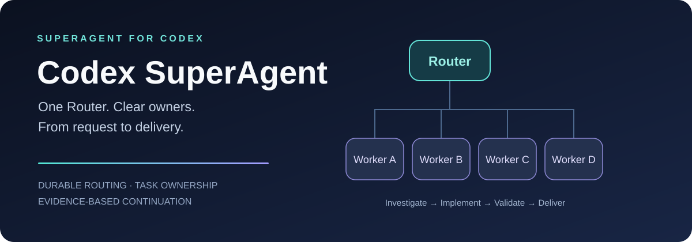

# Codex SuperAgent

**One Router. Clear owners. From request to delivery.**

[简体中文](README.zh-CN.md) · [Install](#get-started) · [Architecture](docs/architecture.md) · [Runtime guide](skills/codex-superagent/references/runtime.md) · [MIT](LICENSE)

**Codex SuperAgent is a community implementation of the SuperAgent Router/Worker architecture for Codex**, inspired by [DeepSeek's SuperAgent prototype](https://github.com/deepseek-ai/dsh-superagent-prototype). It packages the workflow, durable routing code, continuation tools and a local dashboard into a reusable Codex skill.

A lightweight Router assigns ownership. Each Worker takes a complete task through investigation, implementation, validation and repairs. Follow-ups go straight to the task owner, so the Router can keep coordinating while development continues.

This is an independent project, unaffiliated with DeepSeek or OpenAI. It adapts the architecture to Codex's available interfaces; it does not run the DeepSeek Harness.

## Why we built it

Our earlier project, [Agent Relay](https://github.com/lishuoipad/agent-relay), began with a practical limit: the Codex environment we used allowed three concurrent subagents per conversation. We coordinated several conversations to handle more independent work. That was an observed limit in our environment, not a universal Codex limit.

The next problem was coordination: a lead busy with testing could become the queue for everyone else's work. Codex SuperAgent separates **routing from technical ownership**. A Worker waiting for a phone, build or dependency keeps its task; unrelated work can move forward with another owner.

## What you get

- **Complete-task ownership.** Workers investigate, design, implement, integrate, validate and repair their own tasks.
- **Durable routing.** SQLite stores bindings, subscriptions, event identity and delivery intent across process restarts.
- **Plan-based continuation.** Read the existing project plan and acceptance records, separate development dependencies from acceptance dependencies, and identify eligible next work.
- **Pause-aware capacity.** Count unfinished tasks, including waiting and paused ones, against an explicit Worker limit. Preserve independent task pauses.
- **A local dashboard.** See the current Router, Workers, subagents, public progress and plan associations without model calls.

Task handoffs also keep **Worker chat titles aligned with accepted tasks**, with a native readback check. Where a project requires cleanup, existing deliveries record **storage closeout**: what was removed, what must stay and who rechecks it. These checks do not run background deletion or claim unmeasured disk savings.

## The architecture

~~~mermaid
flowchart LR
    U[Human request] --> R[Router: ownership and dependencies]
    R --> A[Worker A: complete task]
    R --> B[Worker B: complete task]
    R --> C[Worker C: complete task]
    R --> D[Worker D: complete task]
    E[Known-task follow-up or completion event] --> A
    A --> O[Evidence and scoped result]
    O --> R
    R --> U
    S[(Durable routing state)] -.-> R
    S -.-> A
~~~

| Role | Responsibility |
| --- | --- |
| **Router** | Preserve the request, select the task owner, coordinate cross-task dependencies and conflicts, forward meaningful results. |
| **Worker** | Own the full technical outcome, including shared wiring assigned to that task, affected validation and repairs. Use internal subagents when authorized and useful. |

One file has one writer. Device and desktop input still use the project's existing exclusive-access mechanisms. Ordinary technical decisions stay with the Worker.

## Get started

Ask Codex's skill installer:

~~~text
Use $skill-installer to install:
https://github.com/lishuoipad/codex-superagent/tree/main/skills/codex-superagent
~~~

Then give it a concrete project and scope. The first-time setup example below uses **one Router and four Workers (five chats total)**. Four is an adjustable project cap, not a fixed Codex or SuperAgent limit; match it to ready tasks and the actual host capacity:

~~~text
Use $codex-superagent for this project's existing development plan.
Set up one Router chat and four complete-task Worker chats.
I authorize creating these five chats and direct project assignment,
interface, dependency and delivery messages among them.
Set the independent Worker cap to 4; preserve existing acceptance criteria.
Verify the setup and keep development paused until I explicitly start it.
~~~

Setup is guided by the skill and the chat tools your host actually exposes. **The native multi-chat workflow requires host tools for chat creation, inspection and authorized messaging.** If those are unavailable, use explicitly identified existing chats and manual handoffs; do not claim automatic continuation. Installing the skill alone does not create a team, start a service or begin development.

Manual installation: copy the entire `skills/codex-superagent` folder into a skill location supported by your client. Consult the [official Codex skill documentation](https://learn.chatgpt.com/docs/build-skills); avoid duplicate installations. Existing Agent Relay teams should review the role and binding changes before switching skills.

### Try the routing core without a Codex session

Python 3.10+; standard library only:

~~~bash
git clone https://github.com/lishuoipad/codex-superagent.git
cd codex-superagent
python -B examples/offline_demo.py
python -B -m unittest discover -s tests -v
~~~

The demo uses fictional identities and temporary state. It routes a known task to its Worker and a new request to the Router, while keeping development paused. It makes no model calls and sends no messages.

For real configuration, event delivery and continuation, read the [runtime guide](skills/codex-superagent/references/runtime.md). For the Windows dashboard, use its [configuration and launch guide](tools/development-status/README.md).

## What is implemented, and what needs your host?

| Capability | Current boundary |
| --- | --- |
| Task ownership, capacity, pause gates and event deduplication | Implemented in the local runtime; covered by offline tests. |
| Native-chat delivery | The adapter records intent, outcome and consumption; an authorized Codex caller invokes the actual chat tool. Separate tool calls are not atomic. |
| Continuing the project plan | The selector proposes eligible work. The Router dispatches it; the technical Owner supplies current evidence and acceptance facts. |
| Periodic missed-event checks | Can use one user-authorized native follow-up in the Router chat. Scheduling and real wakeup must be verified on that host. |
| Optional RPC delivery | Requires an existing compatible control socket and a matching verification receipt. No second backend or private-IPC fallback. |
| Role separation | Enforced by workflow instructions and local routing checks, not a Codex-wide tool sandbox. |
| Dashboard | Reads recorded state; it is not authoritative instantaneous execution status. |

The reference deployment has verified native-message handoffs and task consumption. That does not prove every Codex version exposes the same interfaces or that development can run indefinitely unattended.

Worker capacity is configurable, not an instruction to fill every slot. Creating more chats requires explicit human authorization. Account quotas, model limits and host subagent limits still apply. This package does not automatically switch models, restore WebSocket transport, bypass approvals or add multi-device switching.

## Repository map

~~~text
skills/codex-superagent/   Installable skill, runtime code and focused guides
tools/development-status/ Optional Windows dashboard
examples/                 Offline routing demo
tests/                    Runtime, delivery, continuation and dashboard checks
docs/architecture.md      Design, provenance and implementation boundaries
~~~

## Origins and contributing

The implementation grew from [Agent Relay](https://github.com/lishuoipad/agent-relay) and practical multi-chat development. The design draws on DeepSeek's [execution model](https://github.com/deepseek-ai/dsh-superagent-prototype/blob/6337fc823ce20251c8de8085948165c81aaa701e/docs/003-execution.md) and [architecture](https://github.com/deepseek-ai/dsh-superagent-prototype/blob/6337fc823ce20251c8de8085948165c81aaa701e/docs/007-architecture.md). See [NOTICE](NOTICE) for provenance.

Contributions should start from a reproducible coordination failure. Include the smallest relevant evidence and affected tests. Use fictional identities; exclude credentials, private source, personal paths and live conversation data.

**Less coordination overhead. Clearer ownership. Evidence before completion.**
