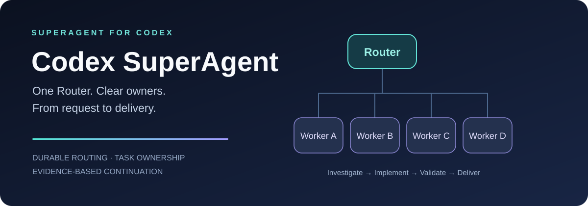

# Codex SuperAgent

**一个 Router，让每项工作都有负责人，从接单走到交付。**

[English](README.md) · [安装](#开始使用) · [架构说明](docs/architecture.md) · [运行时指南](skills/codex-superagent/references/runtime.zh-CN.md) · [MIT 许可](LICENSE)

**Codex SuperAgent 是 SuperAgent 的 Router／Worker 架构在 Codex 上的一个社区实现**，设计受 [DeepSeek 开源 SuperAgent 原型](https://github.com/deepseek-ai/dsh-superagent-prototype)启发。它将工作规则、持久路由、原计划接续和本机看板整理成可复用的 Codex skill。

Router 负责接单、归属和跨任务协调。每个 Worker 对一项完整任务的调查、实现、验证和返修负责。已有任务的后续消息直接交给负责人，让 Router 保持轻量，让开发各自推进。

本项目由社区独立维护，与 DeepSeek、OpenAI 无官方隶属关系；采用 Codex 当前可用的宿主接口，不运行 DeepSeek Harness。

## 为什么做它

前身 [Agent Relay](https://github.com/lishuoipad/agent-relay) 起源于一个实际限制：**我们当时使用的 Codex 环境，每个对话最多同时使用 3 个子智能体**。于是，我们让多个对话协作，各自在真实额度内使用子智能体。这个数字描述当时的环境，并非所有 Codex 版本的固定上限。

后来，更明显的问题变成了协调：当主执行者忙于手机测试或技术整合，其他任务容易排队等待。新架构将**任务路由与技术负责分开**。某个 Worker 等待设备、构建或依赖时，仍然保留原任务；其他无冲突工作可以由各自负责人继续推进。

## 它带来了什么

- **完整任务负责制**：Worker 从调查、方案、代码和接线，一直负责到受影响验证与返修。
- **可恢复的路由记录**：SQLite 保存任务绑定、订阅、事件身份与发送意图，重启后可核对原状态。
- **沿原计划接续**：读取已有开发计划和验收记录，区分开发依赖与验收依赖，找出下一项真正就绪的工作。
- **尊重暂停和容量**：等待、暂停、审批和返修中的未完成任务都占用名额，团队恢复不覆盖专项暂停。
- **看得见的工作状态**：本机看板展示 Router、Worker、子智能体、公开进展及计划关联，不调用模型。

任务交接还会让 **Worker 对话标题跟随已接收的完整任务**，并核对实际标题。项目要求清理时，在原交付中记录**存储收尾**：删了什么、保留什么、由谁复核。这些检查不运行后台删除，也不把未经测量的占用写成释放量。

## 分工一眼看清

~~~mermaid
flowchart LR
    U[用户要求] --> R[Router：任务归属与依赖协调]
    R --> A[Worker A：完整任务]
    R --> B[Worker B：完整任务]
    R --> C[Worker C：完整任务]
    R --> D[Worker D：完整任务]
    E[已有任务的跟进与完成事件] --> A
    A --> O[证据与交付结果]
    O --> R
    R --> U
    S[(持久路由状态)] -.-> R
    S -.-> A
~~~

| 角色 | 负责什么 |
| --- | --- |
| **Router** | 保留原始要求、确定任务负责人、协调跨任务依赖和冲突、转达有意义的结果。 |
| **Worker** | 完整任务的调查、实现、共享接线、验证、交付和返修；在授权与宿主额度内使用内部子智能体。 |

一个文件同一时刻只有一个写者。手机、桌面鼠标键盘等共享资源继续使用项目原有互斥入口。普通技术决定由 Worker 自主处理。

## 开始使用

向 Codex 的技能安装器发送：

~~~text
使用 $skill-installer 安装：
https://github.com/lishuoipad/codex-superagent/tree/main/skills/codex-superagent
~~~

然后给出明确的项目范围。下面的首次接入示例采用 **1 个 Router + 4 个 Worker，共 5 个对话**。4 是可调整的项目上限，并非 Codex 或 SuperAgent 的固定上限；应结合实际就绪任务与宿主容量设置：

~~~text
使用 $codex-superagent，沿用这个项目已有的开发计划。
建立 1 个 Router 对话和 4 个完整任务 Worker 对话。
我授权创建这 5 个对话，并允许它们就本项目直接互发派工、
接口、依赖、交付和接收消息。
独立 Worker 上限设为 4，保留原有验收标准。
先核验架构，保持开发暂停，等我明确要求启动。
~~~

接入过程由 skill 按现有工程和宿主能力执行。**原生多对话协作需要 Codex 宿主提供创建、查看和已授权消息发送工具。** 缺少这些工具时，使用明确指定的既有对话和人工交接，不能声称已经自动接续。安装 skill 本身不会创建团队、安装后台服务或开始开发。

手工安装可复制完整的 `skills/codex-superagent` 文件夹到客户端支持的技能目录，位置以[官方技能文档](https://learn.chatgpt.com/docs/build-skills)为准，避免重复安装。已有 Agent Relay 团队先核对角色与任务绑定，再决定切换。

### 先离线体验路由核心

Python 3.10 及以上，仅使用标准库：

~~~bash
git clone https://github.com/lishuoipad/codex-superagent.git
cd codex-superagent
python -B examples/offline_demo.py
python -B -m unittest discover -s tests -v
~~~

示例使用虚构身份与临时数据：已知任务路由给 Worker，新请求路由给 Router，开发开关始终保持暂停。它不会调用模型或发送消息。

真实配置与事件接入见[运行时指南](skills/codex-superagent/references/runtime.zh-CN.md)；Windows 看板见[配置与启动说明](tools/development-status/README.md)。

## 实现到了哪一步

| 能力 | 当前范围 |
| --- | --- |
| 任务绑定、名额、暂停与事件去重 | 已有本地实现及离线测试。 |
| 原生聊天消息投递 | 适配器记录意图、结果和消费；有授权的 Codex 调用方执行实际消息工具。跨工具操作并非原子事务。 |
| 持续推进原计划 | 选择器提出有据候选，Router 负责派发，技术 Owner 维护真实就绪与验收事实。 |
| 定时补查漏接事件 | 可使用一个经用户授权的 Router 原生回访；须核验宿主实际唤醒和接续。 |
| 可选 RPC 投递 | 需要原宿主已有的兼容控制 socket 和匹配验证回执；不另开后端或使用私有 IPC 回退。 |
| 职责分离 | 依靠角色规则和本地路由检查，不冒称 Codex 全局工具权限硬隔离。 |
| 本机看板 | 展示已落盘记录及其时间，不代表瞬时执行状态。 |

参考部署已核验原生消息交接、任务接收与实际接续。这不证明所有 Codex 版本都有相同接口，也不保证无限期无人值守开发。

Worker 上限由项目明确设置，空位不等于应当补满，新增聊天须有明确人类授权。账户额度、模型容量和宿主子智能体限制继续有效。本项目不自动切换模型、恢复 WebSocket、绕过审批或增加多设备切换。

## 仓库内容

~~~text
skills/codex-superagent/   可安装 skill、运行时代码与按需阅读的指南
tools/development-status/ 可选 Windows 桌面看板
examples/                 离线路由示例
tests/                    路由、投递、接续和看板检查
docs/architecture.md      架构、来源与实现边界
~~~

## 来源与贡献

实现承接 [Agent Relay](https://github.com/lishuoipad/agent-relay) 的工程积累；设计参考 DeepSeek 的[执行模型](https://github.com/deepseek-ai/dsh-superagent-prototype/blob/6337fc823ce20251c8de8085948165c81aaa701e/docs/003-execution.md)及[架构说明](https://github.com/deepseek-ai/dsh-superagent-prototype/blob/6337fc823ce20251c8de8085948165c81aaa701e/docs/007-architecture.md)。来源说明见 [NOTICE](NOTICE)。

欢迎从可复现的协调问题出发贡献改进。提交最小必要证据与受影响测试；示例使用虚构身份，不包含凭据、私有源码、个人路径或真实对话记录。

**减少协调负担，明确任务归属，用证据确认完成。**
